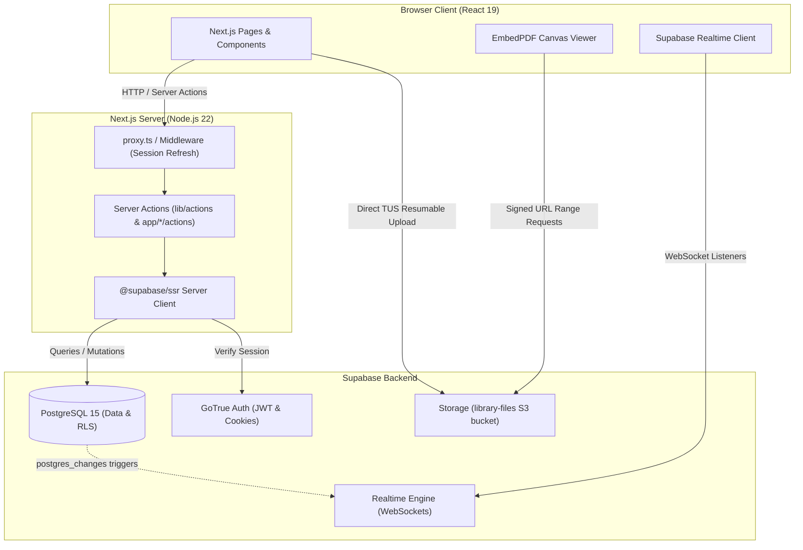
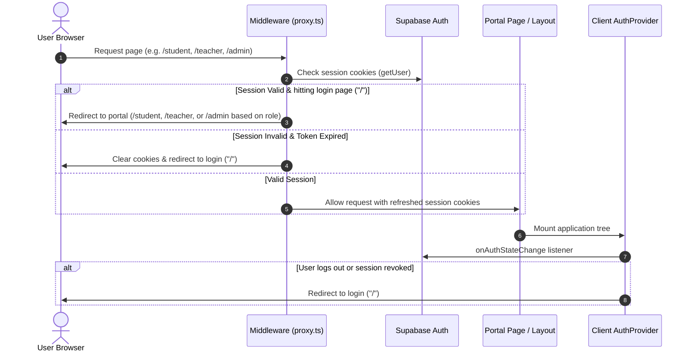
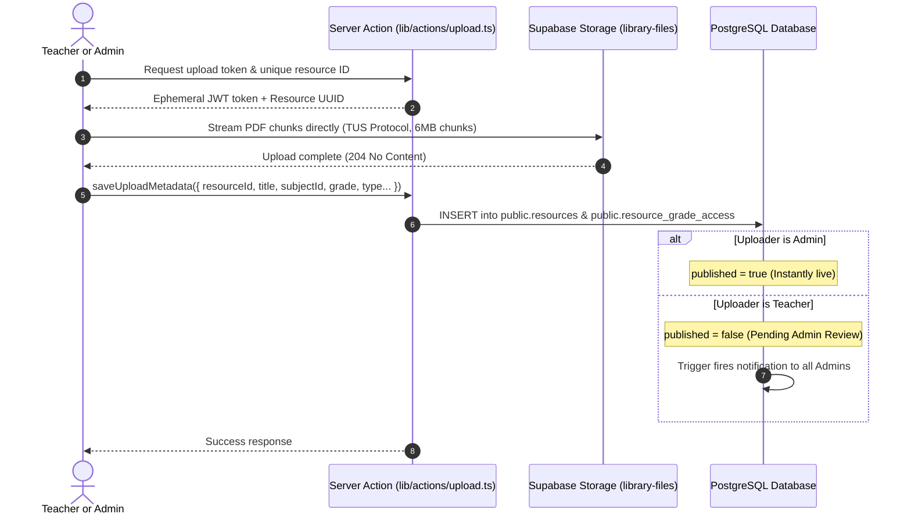
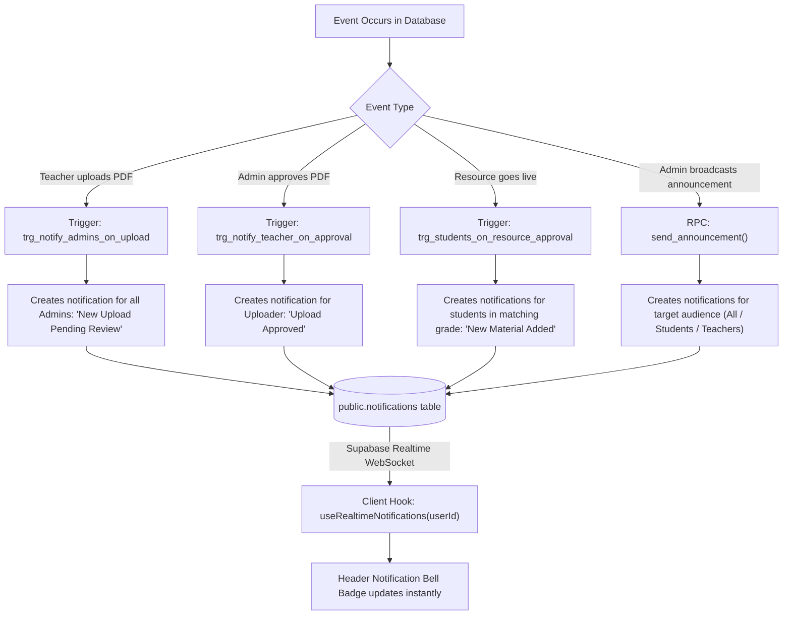

# System Architecture

This document explains how the eLibrary platform works, how data flows between the client and server, and how core features (auth, uploads, PDF viewing, realtime notifications) are implemented.

---

## 1. High-Level Architecture

The platform is a full-stack Next.js 16 application backed by Supabase for authentication, PostgreSQL database, file storage, and realtime WebSocket notifications.



---

## 2. Folder Structure

Here is how the project is organized:

```text
app/                      # Next.js App Router
├── admin/                # Admin portal: approvals, library, users, reports, settings
├── student/              # Student portal: grade library, bookmarks, recent, PDF viewer
├── teacher/              # Teacher portal: upload materials, student roster, analytics
├── actions.ts            # Core server actions: login, signOut, profile, changePassword
└── globals.css           # Tailwind CSS theme variables and styles

components/               # React UI Components
├── admin/                # Admin dialogs, tables, metrics cards
├── student/              # Book cards, grade filters, subject carousels
├── teacher/              # Upload modal, review lists
├── shared/               # Header, sidebar, notification center, PDF viewer wrappers
├── layouts/              # Role-specific layouts (AdminLayout, StudentLayout, etc.)
├── providers/            # AuthProvider (session state & route guards)
└── ui/                   # Reusable UI components (buttons, inputs, dialogs)

lib/                      # Core Business Logic & Utilities
├── actions/              # Shared server actions (upload, viewer, reading-progress, notifications)
├── constants/            # Subjects list, navigation links, defaults
├── context/              # React contexts (AuthContext, UploadContext)
├── hooks/                # Custom hooks (useRealtimeNotifications, useSearch, etc.)
├── supabase/             # Supabase clients (client.ts, server.ts, admin.ts, middleware.ts)
└── types/                # TypeScript types

docs/                     # Developer guides (architecture, database, security, setup)
supabase/                 # Supabase configuration and SQL migrations
```

---

## 3. Authentication & Routing

### Auth Flow & Role Redirects

Authentication uses Supabase Auth with server-side cookie management (`@supabase/ssr`).



### User Portals

Users belong to one of three roles, defined in `public.app_role`:

| Role        | Portal Root | Purpose                                                                                              |
| :---------- | :---------- | :--------------------------------------------------------------------------------------------------- |
| **Student** | `/student`  | Access curriculum books for their grade, track reading progress, take notes, bookmark materials.     |
| **Teacher** | `/teacher`  | Upload resources for students, view student reading analytics, track upload approval status.         |
| **Admin**   | `/admin`    | Approve/reject teacher uploads, manage user accounts, send school-wide announcements, adjust grades. |

---

## 4. File Upload Flow

PDFs are uploaded directly from the browser to Supabase Storage using the **TUS resumable upload protocol**, instead of passing large files through the Next.js server:



---

## 5. PDF Viewer & Reading Progress

### PDF Streaming

All study materials are stored in the private `library-files` storage bucket.

1. When a student opens `/student/viewer/[id]`, the server creates a **temporary signed URL** valid for 1 hour.
2. The browser renders the PDF using `@embedpdf/*` (using `pdfjs-dist`).
3. The viewer streams only the pages currently being viewed using HTTP range requests (`bytes=start-end`), keeping bandwidth low and initial load times fast.

### Reading Progress & Notes

- **Reading Progress**: As the student scrolls through pages, the viewer debounces progress updates (every 2 seconds of inactivity) and updates `last_page` and `progress_pct` in `public.reading_progress`.
- **Annotations & Notes**: Students can highlight text, draw boxes, and save sticky notes on specific pages. These are serialized as JSON and stored in `public.resource_annotations`.

---

## 6. Realtime Notifications

The platform updates users in real time using **Supabase Realtime** (listening for changes on the `notifications` table):



Clients subscribe to their personal notification channel:

```typescript
supabase
  .channel(`notifications:${userId}`)
  .on(
    'postgres_changes',
    {
      event: 'INSERT',
      schema: 'public',
      table: 'notifications',
      filter: `user_id=eq.${userId}`,
    },
    (payload) => {
      // Updates badge count and appends to notification dropdown
    },
  )
  .subscribe();
```
