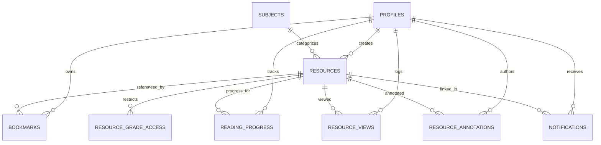

# Database Schema & Tables

## 1. Extensions & Enums

### PostgreSQL Extensions

```sql
CREATE EXTENSION IF NOT EXISTS pgcrypto;
CREATE EXTENSION IF NOT EXISTS pg_trgm;
```

### Enums

```sql
CREATE TYPE public.app_role AS ENUM (
  'admin',
  'teacher',
  'student'
);

CREATE TYPE public.material_type AS ENUM (
  'textbook',
  'guide',
  'question_bank',
  'reference',
  'model_paper',
  'sample_paper',
  'lab_material',
  'school_material',
  'others'
);
```

## 2. Schema & Entity Relationship Diagram



### 2.1 `public.profiles`

User profile table synchronized with `auth.users` through trigger `on_auth_user_created`.

| Column       | Type              | Constraints                                                  | Default                  | Description                     |
| :----------- | :---------------- | :----------------------------------------------------------- | :----------------------- | :------------------------------ |
| `id`         | `uuid`            | `PRIMARY KEY`, `REFERENCES auth.users(id) ON DELETE CASCADE` | -                        | Matches Supabase Auth user UUID |
| `full_name`  | `text`            | `NULL`                                                       | `NULL`                   | Student or staff full name      |
| `email`      | `text`            | `UNIQUE`                                                     | -                        | Normalized user email address   |
| `role`       | `public.app_role` | `NOT NULL`                                                   | `'student'`              | Authorization role partition    |
| `grade`      | `smallint`        | `CHECK (grade BETWEEN 1 AND 10 OR grade IS NULL)`            | `NULL`                   | Academic grade level (1-10)     |
| `is_active`  | `boolean`         | `NOT NULL`                                                   | `true`                   | Soft-delete / suspension flag   |
| `created_at` | `timestamptz`     | `NOT NULL`                                                   | `timezone('utc', now())` | Record insertion timestamp      |
| `updated_at` | `timestamptz`     | `NOT NULL`                                                   | `timezone('utc', now())` | Record last modification        |

**Table Constraints:**

- `profiles_student_grade_check`: `CHECK ((role = 'student' AND grade BETWEEN 1 AND 10) OR (role IN ('admin', 'teacher')))`

---

### 2.2 `public.subjects`

Academic discipline taxonomy.

| Column       | Type          | Constraints          | Default                  | Description                |
| :----------- | :------------ | :------------------- | :----------------------- | :------------------------- |
| `id`         | `bigserial`   | `PRIMARY KEY`        | Sequence                 | Auto-increment primary key |
| `name`       | `text`        | `NOT NULL`, `UNIQUE` | -                        | Canonical subject name     |
| `created_at` | `timestamptz` | `NOT NULL`           | `timezone('utc', now())` | Record insertion timestamp |

**Default Seed Taxonomy:** `Mathematics`, `Science`, `English`, `Hindi`, `Social Science`, `Computer Science`, `Sanskrit`, `EVS`, `Kannada`, `Information Technology`, `Artificial Intelligence`, `Art Education`, `Value Education`, `General Knowledge`, `Physical Education`, `Vocational Education`.

---

### 2.3 `public.resources`

Primary academic document repository index.

| Column            | Type                   | Constraints                                                     | Default                  | Description                        |
| :---------------- | :--------------------- | :-------------------------------------------------------------- | :----------------------- | :--------------------------------- |
| `id`              | `uuid`                 | `PRIMARY KEY`                                                   | `gen_random_uuid()`      | Internal unique identifier         |
| `book_id`         | `text`                 | `NULL`                                                          | `NULL`                   | External curriculum identifier     |
| `title`           | `text`                 | `NOT NULL`                                                      | -                        | Document title                     |
| `description`     | `text`                 | `NULL`                                                          | `NULL`                   | Optional descriptive summary       |
| `subject_id`      | `bigint`               | `NOT NULL`, `REFERENCES public.subjects(id) ON DELETE RESTRICT` | -                        | Foreign key to subjects table      |
| `material_type`   | `public.material_type` | `NOT NULL`                                                      | -                        | Document category                  |
| `academic_year`   | `text`                 | `NULL`                                                          | `NULL`                   | Format: `YYYY` or `YYYY-YY`        |
| `storage_path`    | `text`                 | `NULL`                                                          | `NULL`                   | Path inside `library-files` bucket |
| `source_url`      | `text`                 | `NULL`                                                          | `NULL`                   | External CDN / government URL      |
| `file_mime`       | `text`                 | `NULL`                                                          | `NULL`                   | Enforced PDF MIME type             |
| `file_size_bytes` | `bigint`               | `NULL`                                                          | `NULL`                   | File size in bytes                 |
| `page_count`      | `integer`              | `NULL`                                                          | `NULL`                   | Total PDF page count               |
| `thumbnail_url`   | `text`                 | `NULL`                                                          | `NULL`                   | Optional cover preview image URL   |
| `published`       | `boolean`              | `NOT NULL`                                                      | `true`                   | Admin moderation approval flag     |
| `is_active`       | `boolean`              | `NOT NULL`                                                      | `true`                   | Soft delete flag                   |
| `created_by`      | `uuid`                 | `NOT NULL`, `REFERENCES public.profiles(id) ON DELETE RESTRICT` | -                        | Uploader profile ID                |
| `updated_by`      | `uuid`                 | `NULL`, `REFERENCES public.profiles(id) ON DELETE SET NULL`     | `NULL`                   | Modifier profile ID                |
| `created_at`      | `timestamptz`          | `NOT NULL`                                                      | `timezone('utc', now())` | Creation timestamp                 |
| `updated_at`      | `timestamptz`          | `NOT NULL`                                                      | `timezone('utc', now())` | Update timestamp                   |

**Table Constraints:**

- `resources_pdf_only_check`: `CHECK (file_mime IS NULL OR lower(file_mime) IN ('application/pdf', 'application/x-pdf'))`
- `resources_source_check`: `CHECK ((storage_path IS NOT NULL AND source_url IS NULL) OR (storage_path IS NULL AND source_url IS NOT NULL))`
- `resources_academic_year_check`: `CHECK (academic_year IS NULL OR academic_year ~ '^[0-9]{4}(-[0-9]{2,4})?$')`

---

### 2.4 `public.resource_grade_access`

Grade-level audience junction table. If no rows exist for a resource, the resource is unrestricted.

| Column        | Type          | Constraints                                                     | Default                  | Description                |
| :------------ | :------------ | :-------------------------------------------------------------- | :----------------------- | :------------------------- |
| `resource_id` | `uuid`        | `NOT NULL`, `REFERENCES public.resources(id) ON DELETE CASCADE` | -                        | Target resource            |
| `grade`       | `smallint`    | `NOT NULL`, `CHECK (grade BETWEEN 1 AND 10)`                    | -                        | Authorized grade level     |
| `created_at`  | `timestamptz` | `NOT NULL`                                                      | `timezone('utc', now())` | Record insertion timestamp |

**Primary Key:** `(resource_id, grade)`

---

### 2.5 `public.bookmarks`

Per-user bookmarked materials.

| Column        | Type          | Constraints                                                     | Default                  | Description          |
| :------------ | :------------ | :-------------------------------------------------------------- | :----------------------- | :------------------- |
| `user_id`     | `uuid`        | `NOT NULL`, `REFERENCES public.profiles(id) ON DELETE CASCADE`  | -                        | User foreign key     |
| `resource_id` | `uuid`        | `NOT NULL`, `REFERENCES public.resources(id) ON DELETE CASCADE` | -                        | Resource foreign key |
| `created_at`  | `timestamptz` | `NOT NULL`                                                      | `timezone('utc', now())` | Creation timestamp   |

**Primary Key:** `(user_id, resource_id)`

---

### 2.6 `public.reading_progress`

Viewer telemetry and bookmark persistence.

| Column           | Type           | Constraints                                                     | Default                  | Description                   |
| :--------------- | :------------- | :-------------------------------------------------------------- | :----------------------- | :---------------------------- |
| `user_id`        | `uuid`         | `NOT NULL`, `REFERENCES public.profiles(id) ON DELETE CASCADE`  | -                        | Profile reference             |
| `resource_id`    | `uuid`         | `NOT NULL`, `REFERENCES public.resources(id) ON DELETE CASCADE` | -                        | Resource reference            |
| `last_page`      | `integer`      | `NOT NULL`, `CHECK (last_page >= 1)`                            | `1`                      | Last rendered viewport page   |
| `progress_pct`   | `numeric(5,2)` | `NOT NULL`, `CHECK (progress_pct >= 0 AND progress_pct <= 100)` | `0`                      | Calculated reading percentage |
| `last_viewed_at` | `timestamptz`  | `NOT NULL`                                                      | `timezone('utc', now())` | Latest viewport interaction   |
| `created_at`     | `timestamptz`  | `NOT NULL`                                                      | `timezone('utc', now())` | Record insertion timestamp    |
| `updated_at`     | `timestamptz`  | `NOT NULL`                                                      | `timezone('utc', now())` | Record update timestamp       |

**Primary Key:** `(user_id, resource_id)`

---

### 2.7 `public.resource_views`

Raw access audit log for usage analytics.

| Column        | Type          | Constraints                                                     | Default                  | Description          |
| :------------ | :------------ | :-------------------------------------------------------------- | :----------------------- | :------------------- |
| `id`          | `bigserial`   | `PRIMARY KEY`                                                   | Sequence                 | View event ID        |
| `user_id`     | `uuid`        | `NOT NULL`, `REFERENCES public.profiles(id) ON DELETE CASCADE`  | -                        | Viewer profile ID    |
| `resource_id` | `uuid`        | `NOT NULL`, `REFERENCES public.resources(id) ON DELETE CASCADE` | -                        | Accessed resource ID |
| `viewed_at`   | `timestamptz` | `NOT NULL`                                                      | `timezone('utc', now())` | Event timestamp      |

---

### 2.8 `public.resource_annotations`

Serialized PDF annotations (highlights, sticky notes, drawn bounding rects).

| Column            | Type          | Constraints                                                     | Default                  | Description                            |
| :---------------- | :------------ | :-------------------------------------------------------------- | :----------------------- | :------------------------------------- |
| `id`              | `uuid`        | `PRIMARY KEY`                                                   | `gen_random_uuid()`      | Annotation unique ID                   |
| `user_id`         | `uuid`        | `NOT NULL`, `REFERENCES auth.users(id) ON DELETE CASCADE`       | -                        | Author ID                              |
| `resource_id`     | `uuid`        | `NOT NULL`, `REFERENCES public.resources(id) ON DELETE CASCADE` | -                        | Resource target                        |
| `page_number`     | `integer`     | `NULL`                                                          | `NULL`                   | Page index of annotation               |
| `annotation_data` | `jsonb`       | `NOT NULL`                                                      | -                        | Payload (`{type, rects, color, note}`) |
| `created_at`      | `timestamptz` | `NOT NULL`                                                      | `timezone('utc', now())` | Creation timestamp                     |
| `updated_at`      | `timestamptz` | `NOT NULL`                                                      | `timezone('utc', now())` | Update timestamp                       |

---

### 2.9 `public.notifications`

In-app messaging, approval notices, and broadcast system.

| Column        | Type          | Constraints                                                                                 | Default                  | Description              |
| :------------ | :------------ | :------------------------------------------------------------------------------------------ | :----------------------- | :----------------------- |
| `id`          | `uuid`        | `PRIMARY KEY`                                                                               | `gen_random_uuid()`      | Notification ID          |
| `user_id`     | `uuid`        | `NOT NULL`, `REFERENCES public.profiles(id) ON DELETE CASCADE`                              | -                        | Recipient profile ID     |
| `title`       | `text`        | `NOT NULL`                                                                                  | -                        | Notification title       |
| `message`     | `text`        | `NOT NULL`                                                                                  | -                        | Notification body        |
| `link`        | `text`        | `NOT NULL`                                                                                  | `''`                     | Deep link path in portal |
| `resource_id` | `uuid`        | `NULL`, `REFERENCES public.resources(id) ON DELETE CASCADE`                                 | `NULL`                   | Associated resource      |
| `type`        | `text`        | `NOT NULL`, `CHECK (type IN ('new_upload','approved','rejected','new_material','general'))` | `'general'`              | Category discriminator   |
| `is_read`     | `boolean`     | `NOT NULL`                                                                                  | `false`                  | Read receipt flag        |
| `created_at`  | `timestamptz` | `NOT NULL`                                                                                  | `timezone('utc', now())` | Dispatch timestamp       |

---

### 2.10 `public.app_settings`

Singleton platform settings configuration.

| Column                    | Type      | Constraints                     | Default      | Description                         |
| :------------------------ | :-------- | :------------------------------ | :----------- | :---------------------------------- |
| `id`                      | `integer` | `PRIMARY KEY`, `CHECK (id = 1)` | `1`          | Singleton row lock                  |
| `platform_name`           | `text`    | `NOT NULL`                      | `'eLibrary'` | Configured application name         |
| `school_name`             | `text`    | `NOT NULL`                      | `''`         | Institutional school name           |
| `allow_all_grades_access` | `boolean` | `NOT NULL`                      | `false`      | Global bypass flag for grade access |

## 3. Database Views

### 3.1 `public.student_engagement_summary`

Aggregated institutional student metrics for CSV/PDF report actions.

```sql
CREATE OR REPLACE VIEW student_engagement_summary AS
SELECT
  p.id AS user_id,
  p.full_name,
  p.email,
  p.grade,
  p.is_active,
  p.created_at AS joined_at,
  COUNT(DISTINCT rv.resource_id) AS unique_resources_accessed,
  COUNT(rv.id) AS total_views,
  COALESCE(ROUND(AVG(rp.progress_pct)::numeric, 1), 0) AS avg_progress,
  COUNT(rp.resource_id) FILTER (WHERE rp.progress_pct >= 80) AS completed_count,
  COUNT(b.resource_id) AS bookmark_count,
  MAX(rv.viewed_at) AS last_active
FROM profiles p
LEFT JOIN resource_views rv ON rv.user_id = p.id
LEFT JOIN reading_progress rp ON rp.user_id = p.id
LEFT JOIN bookmarks b ON b.user_id = p.id
WHERE p.role = 'student'
GROUP BY p.id, p.full_name, p.email, p.grade, p.is_active, p.created_at;
```

### 3.2 View Count Aggregations

To prevent `resource_views` full-table scan limits (>50,000 rows):

- `public.resource_view_counts`: `(resource_id, COUNT(*) AS views)`
- `public.resource_view_monthly`: `(resource_id, user_id, DATE_TRUNC('month', viewed_at) AS month, COUNT(*) AS views)`
- `public.resource_view_daily`: `(resource_id, user_id, DATE_TRUNC('day', viewed_at) AS day, COUNT(*) AS views)`
- `public.resource_unique_viewers`: `(resource_id, COUNT(DISTINCT user_id) AS unique_students)`

## 4. Stored Procedures & RPC Functions

### 4.1 Security Context Functions

```sql
-- Returns the caller's role from profiles
CREATE OR REPLACE FUNCTION public.current_user_role()
RETURNS public.app_role LANGUAGE sql STABLE SECURITY DEFINER SET search_path = public AS $$
  SELECT p.role FROM public.profiles p WHERE p.id = auth.uid();
$$;

-- Returns the caller's grade
CREATE OR REPLACE FUNCTION public.current_user_grade()
RETURNS smallint LANGUAGE sql STABLE SECURITY DEFINER SET search_path = public AS $$
  SELECT p.grade FROM public.profiles p WHERE p.id = auth.uid();
$$;

CREATE OR REPLACE FUNCTION public.is_admin()
RETURNS boolean LANGUAGE sql STABLE SECURITY DEFINER SET search_path = public AS $$
  SELECT coalesce(public.current_user_role() = 'admin', false);
$$;

CREATE OR REPLACE FUNCTION public.is_teacher()
RETURNS boolean LANGUAGE sql STABLE SECURITY DEFINER SET search_path = public AS $$
  SELECT coalesce(public.current_user_role() = 'teacher', false);
$$;
```

### 4.2 Resource Access Evaluator

```sql
CREATE OR REPLACE FUNCTION public.can_access_resource(p_resource_id uuid)
RETURNS boolean LANGUAGE sql STABLE SECURITY DEFINER SET search_path = public AS $$
  WITH me AS (
    SELECT p.role, p.grade, p.is_active FROM public.profiles p WHERE p.id = auth.uid()
  )
  SELECT EXISTS (
    SELECT 1 FROM public.resources r
    CROSS JOIN me
    WHERE r.id = p_resource_id
      AND r.is_active = true
      AND me.is_active = true
      AND (
        me.role IN ('admin', 'teacher')
        OR (
          me.role = 'student'
          AND r.published = true
          AND (
            (SELECT allow_all_grades_access FROM public.app_settings WHERE id = 1) = true
            OR NOT EXISTS (SELECT 1 FROM public.resource_grade_access rga WHERE rga.resource_id = r.id)
            OR EXISTS (SELECT 1 FROM public.resource_grade_access rga WHERE rga.resource_id = r.id AND rga.grade = me.grade)
          )
        )
      )
  );
$$;
```

### 4.3 Student Grade Adjustments

```sql
-- Atomically increment grade for all active students (grades 1-9)
CREATE OR REPLACE FUNCTION public.admin_promote_students()
RETURNS void LANGUAGE plpgsql SECURITY DEFINER SET search_path = public AS $$
BEGIN
  IF NOT public.is_admin() THEN RAISE EXCEPTION 'Unauthorized'; END IF;
  UPDATE public.profiles SET grade = grade + 1 WHERE role = 'student' AND is_active = true AND grade BETWEEN 1 AND 9;
END;
$$;

-- Atomically decrement grade for all active students (grades 2-10)
CREATE OR REPLACE FUNCTION public.admin_demote_students()
RETURNS void LANGUAGE plpgsql SECURITY DEFINER SET search_path = public AS $$
BEGIN
  IF NOT public.is_admin() THEN RAISE EXCEPTION 'Unauthorized'; END IF;
  UPDATE public.profiles SET grade = grade - 1 WHERE role = 'student' AND is_active = true AND grade BETWEEN 2 AND 10;
END;
$$;
```

### 4.4 Student Library Fetcher (`get_student_library`)

Performs a single-pass join aggregating resource metadata, subject name, progress, bookmark status, and authorized grades array:

```sql
CREATE OR REPLACE FUNCTION public.get_student_library(p_user_id uuid)
RETURNS TABLE (
  id uuid, book_id text, title text, material_type text, academic_year text,
  thumbnail_url text, storage_path text, source_url text, page_count integer,
  created_at timestamptz, subject_name text, progress_pct numeric,
  last_page integer, last_viewed_at timestamptz, is_bookmarked boolean, grades integer[]
) LANGUAGE plpgsql STABLE SECURITY DEFINER SET search_path = public;
```

### 4.5 Atomic Mutation RPCs

- `public.toggle_bookmark(p_resource_id uuid) -> boolean`: Atomically checks presence in `public.bookmarks`. Deletes if present (returns `false`), inserts if absent (returns `true`).
- `public.mark_all_notifications_read() -> integer`: Atomically sets `is_read = true` for all unread rows of `auth.uid()`, returning count of updated rows.
- `public.send_announcement(p_title text, p_message text, p_link text, p_role text, p_exclude_user_id uuid) -> bigint`: Fan-out inserts notifications to all active users matching role criteria.

## 5. Triggers & Automation

| Trigger                             | Event           | Source Table            | Target / Function                                                          |
| :---------------------------------- | :-------------- | :---------------------- | :------------------------------------------------------------------------- |
| `trg_profiles_updated_at`           | `BEFORE UPDATE` | `profiles`              | `set_updated_at()`                                                         |
| `trg_resources_updated_at`          | `BEFORE UPDATE` | `resources`             | `set_updated_at()`                                                         |
| `trg_reading_progress_updated_at`   | `BEFORE UPDATE` | `reading_progress`      | `set_updated_at()`                                                         |
| `on_auth_user_created`              | `AFTER INSERT`  | `auth.users`            | `handle_new_auth_user()`                                                   |
| `trg_notify_admins_on_upload`       | `AFTER INSERT`  | `resources`             | `notify_admins_on_upload()` (when teacher creates resource)                |
| `trg_notify_teacher_on_approval`    | `AFTER UPDATE`  | `resources`             | `notify_teacher_on_approval()` (detects `published` or `is_active` change) |
| `trg_students_on_resource_approval` | `AFTER UPDATE`  | `resources`             | `trg_notify_students_on_approval()` (fires `notify_students_for_resource`) |
| `trg_students_on_grade_access`      | `AFTER INSERT`  | `resource_grade_access` | `trg_notify_students_on_grade_access()`                                    |

## 6. Row-Level Security (RLS) Policies

| Table                   | Command                | Target Role     | Policy Definition (`USING` / `WITH CHECK`)                                                                                                 |
| :---------------------- | :--------------------- | :-------------- | :----------------------------------------------------------------------------------------------------------------------------------------- |
| `profiles`              | `SELECT`               | `authenticated` | `id = auth.uid() OR is_admin() OR (is_teacher() AND role = 'student')`                                                                     |
| `profiles`              | `UPDATE`               | `authenticated` | `id = auth.uid() OR is_admin()`                                                                                                            |
| `subjects`              | `SELECT`               | `authenticated` | `true` (unrestricted read)                                                                                                                 |
| `subjects`              | `ALL`                  | `authenticated` | `is_admin()`                                                                                                                               |
| `resources`             | `SELECT`               | `authenticated` | `is_active = true AND (is_admin() OR is_teacher() OR (role = 'student' AND published = true AND (bypass OR unrestricted OR grade_match)))` |
| `resources`             | `INSERT`               | `authenticated` | `is_admin() OR (is_teacher() AND created_by = auth.uid())`                                                                                 |
| `resources`             | `UPDATE`               | `authenticated` | `is_admin() OR (is_teacher() AND created_by = auth.uid())`                                                                                 |
| `resources`             | `DELETE`               | `authenticated` | `is_admin() OR (is_teacher() AND created_by = auth.uid())`                                                                                 |
| `resource_grade_access` | `SELECT`               | `authenticated` | `true`                                                                                                                                     |
| `resource_grade_access` | `WRITE`                | `authenticated` | `is_admin() OR (is_teacher() AND resource.created_by = auth.uid())`                                                                        |
| `bookmarks`             | `SELECT`               | `authenticated` | `user_id = auth.uid() OR is_admin() OR is_teacher()`                                                                                       |
| `bookmarks`             | `INSERT`               | `authenticated` | `user_id = auth.uid() AND can_access_resource(resource_id)`                                                                                |
| `bookmarks`             | `DELETE`               | `authenticated` | `user_id = auth.uid()`                                                                                                                     |
| `reading_progress`      | `SELECT`               | `authenticated` | `user_id = auth.uid() OR is_admin() OR is_teacher()`                                                                                       |
| `reading_progress`      | `INSERT/UPDATE`        | `authenticated` | `user_id = auth.uid() AND can_access_resource(resource_id)`                                                                                |
| `resource_annotations`  | `SELECT`               | `authenticated` | `user_id = auth.uid() OR is_admin() OR is_teacher()`                                                                                       |
| `resource_annotations`  | `INSERT/UPDATE/DELETE` | `authenticated` | `user_id = auth.uid()`                                                                                                                     |
| `resource_views`        | `SELECT`               | `authenticated` | `user_id = auth.uid() OR is_admin() OR is_teacher()`                                                                                       |
| `resource_views`        | `INSERT`               | `authenticated` | `user_id = auth.uid() AND can_access_resource(resource_id)`                                                                                |
| `notifications`         | `SELECT`               | `authenticated` | `user_id = auth.uid()`                                                                                                                     |
| `notifications`         | `UPDATE/DELETE`        | `authenticated` | `user_id = auth.uid()`                                                                                                                     |
| `notifications`         | `INSERT`               | `authenticated` | `true` (service triggers / internal actions)                                                                                               |
| `app_settings`          | `SELECT`               | `public`        | `true`                                                                                                                                     |
| `app_settings`          | `UPDATE`               | `authenticated` | `is_admin()`                                                                                                                               |

## 7. Storage Bucket Configuration

### Bucket: `library-files`

- **Visibility:** Private (`public = false`)
- **Max File Size:** 104,857,600 bytes (100 MB)
- **Allowed MIME:** `['application/pdf']`

### Storage Policies (`storage.objects`)

```sql
-- Read Policy
CREATE POLICY storage_library_files_read ON storage.objects
FOR SELECT TO authenticated
USING (
  bucket_id = 'library-files'
  AND (
    public.is_admin()
    OR public.is_teacher()
    OR public.can_access_resource(public.resource_id_from_storage_path(name))
  )
);

-- Write Policies (INSERT, UPDATE, DELETE)
CREATE POLICY storage_library_files_write ON storage.objects
FOR ALL TO authenticated
USING (bucket_id = 'library-files' AND (public.is_admin() OR public.is_teacher()))
WITH CHECK (bucket_id = 'library-files' AND (public.is_admin() OR public.is_teacher()));
```

## 8. Indexes & Performance Optimization

```sql
CREATE INDEX resources_subject_idx ON public.resources(subject_id);
CREATE INDEX resources_material_type_idx ON public.resources(material_type);
CREATE INDEX resources_created_at_idx ON public.resources(created_at DESC);
CREATE INDEX resources_active_published_idx ON public.resources(is_active, published);
CREATE INDEX resources_title_trgm_idx ON public.resources USING gin (title gin_trgm_ops);
CREATE INDEX resource_grade_access_grade_idx ON public.resource_grade_access(grade);
CREATE INDEX bookmarks_user_created_idx ON public.bookmarks(user_id, created_at DESC);
CREATE INDEX reading_progress_user_last_viewed_idx ON public.reading_progress(user_id, last_viewed_at DESC);
CREATE INDEX resource_views_resource_viewed_at_idx ON public.resource_views(resource_id, viewed_at DESC);
CREATE INDEX resource_views_user_viewed_at_idx ON public.resource_views(user_id, viewed_at DESC);
CREATE INDEX idx_resource_annotations_user_resource ON public.resource_annotations(user_id, resource_id);
CREATE INDEX notifications_user_created_idx ON public.notifications(user_id, created_at DESC);
CREATE INDEX notifications_user_unread_idx ON public.notifications(user_id, is_read) WHERE is_read = false;
```
