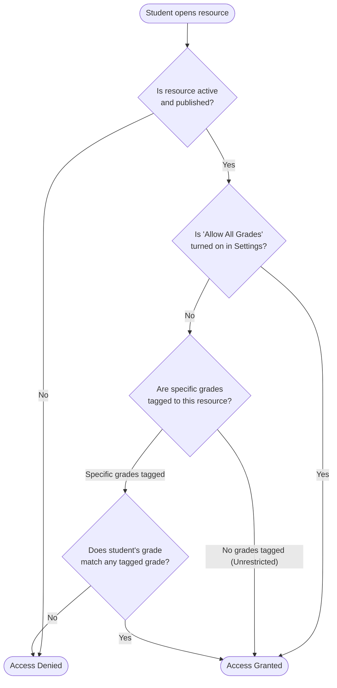

# Security & Auth

This document explains how user roles, grade-based access, cookies, and default passwords work in the app.

---

## 1. User Roles & Permissions

Users belong to one of three roles: `student`, `teacher`, or `admin`.

| Feature / Action                 |     Student      |        Teacher         |        Admin         | Enforcement                                        |
| :------------------------------- | :--------------: | :--------------------: | :------------------: | :------------------------------------------------- |
| **Browse Resources**             | Grade-Restricted |          All           |         All          | Row-Level Security (RLS) on `resources`            |
| **Read PDFs**                    | Grade-Restricted |          All           |         All          | Private bucket with temporary signed URLs          |
| **Upload Materials**             |        ❌        | Yes (Pending Approval) | Yes (Auto-Approved)  | RLS on `resources` + server actions                |
| **Approve / Reject Uploads**     |        ❌        |           ❌           |         Yes          | Admin actions (`app/admin/approvals`)              |
| **Delete Resources**             |        ❌        |    Own Uploads Only    |         All          | RLS on `resources` table                           |
| **Reading Progress & Notes**     |   Own Records    |  Read-Only (Auditing)  | Read-Only (Auditing) | RLS on `reading_progress` & `resource_annotations` |
| **Bookmarks**                    |   Own Records    |       Read-Only        |      Read-Only       | RLS on `bookmarks` table                           |
| **Grade Promotions / Demotions** |        ❌        |           ❌           |         Yes          | Admin actions with password confirmation           |
| **Send Announcements**           |        ❌        |           ❌           |         Yes          | Admin action calling `send_announcement()`         |
| **Manage Users & Import CSV**    |        ❌        |           ❌           |         Yes          | Supabase Auth admin client (server-side)           |
| **System Settings**              |    Read-Only     |       Read-Only        |      Read-Write      | RLS on `app_settings`                              |

---

## 2. Grade-Based Access Control

Students can only see books and study materials meant for their grade (Grades 1 through 10). Access is checked by the database function `public.can_access_resource(p_resource_id)`.

### How Access is Checked

### Unrestricted Materials & Global Settings

- **Unrestricted Books**: If an upload has no specific grades selected, it is considered unrestricted and all students can view it.
- **Allow All Grades Toggle**: In Admin Settings, an admin can turn on **Allow All Grades Access** (`app_settings.allow_all_grades_access = true`). When enabled, any student can view all books regardless of grade (e.g., for library open house or reading weeks).

---

## 3. Sessions & Cookies

Authentication uses `@supabase/ssr` with HTTP-only cookies.

### Remember Me

When logging in, users can check **"Remember Me"**:

- **Checked**: Session cookie lasts 1 year (`31,536,000` seconds).
- **Unchecked**: Session cookie is cleared when the user closes their browser.

### Multi-Tab Lock Handling

Supabase JS uses the Web Locks API (`navigator.locks`) by default. On some mobile browsers or background tabs, locks can hang. The client wraps lock requests with a non-blocking fallback (`nonBlockingAuthLock` in `lib/supabase/client.ts`) so tabs don't freeze if a lock is busy.

---

## 4. Default Passwords

When an admin creates accounts manually or by CSV upload without entering a password, the system generates a default password:

### Password Format

`{FirstName}@{role}{grade}`

- **First Name**: Stripped of spaces and special characters.
- **Student**: Uses `@student` plus grade number.
- **Teacher / Admin**: Uses `@teacher` or `@admin`.
- **Minimum Length**: If the password is fewer than 6 characters, `123` is appended.

### Examples

- Student `John Doe`, Grade 8 -> `John@student8`
- Student `Ananya Sharma`, Grade 5 -> `Ananya@student5`
- Teacher `Sarah Jenkins` -> `Sarah@teacher`
- Student `Bo`, Grade 2 -> `Bo@student2`
- Student `Al`, no grade -> `Al@student123` (padded to meet 6-character minimum)

---

## 5. Admin Server Operations

Admin tasks (like sending school announcements, creating user accounts, and batch updates) run on the server through `lib/supabase/admin.ts`. This client uses the Supabase service role key to bypass Row-Level Security.

It runs only on the server and is never imported into client components.
